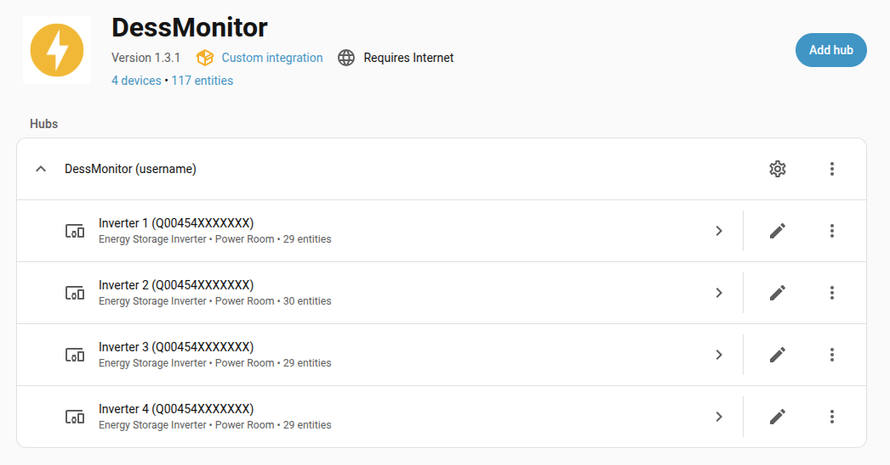
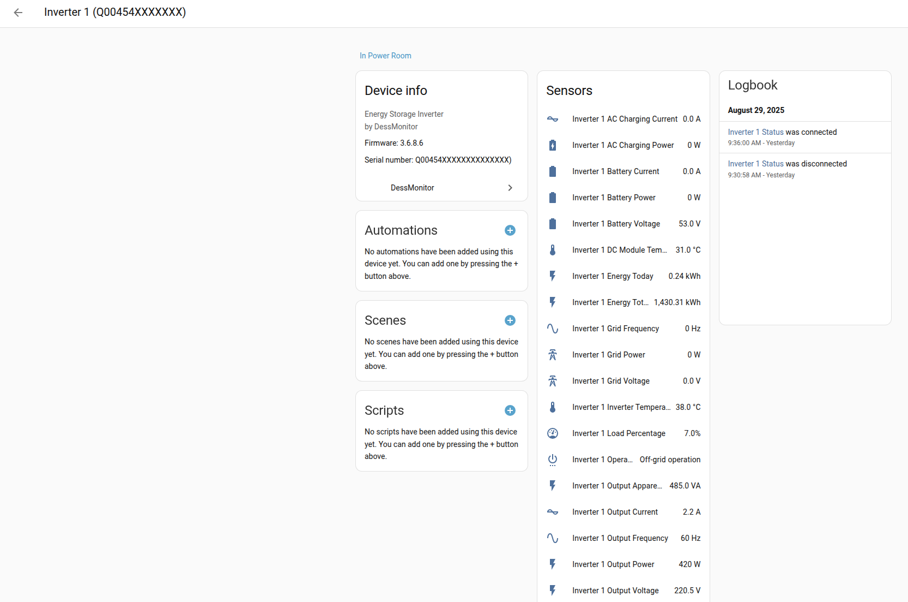

# DessMonitor / ShineMonitor for Home Assistant

[![GitHub Release][releases-shield]][releases]
[![GitHub Activity][commits-shield]][commits]
[![License][license-shield]](LICENSE)
[![hacs][hacsbadge]][hacs]
[![HACS Action][hacs-action-shield]][hacs-action]
[![Hassfest][hassfest-shield]][hassfest]

Monitor your solar inverter and configure supported settings in Home Assistant through **DessMonitor** or **ShineMonitor**. Use the same account as SmartESS, SmartClient for Solar, or a compatible rebranded app.

- Track solar production, battery status, grid use, and inverter health across multiple devices.
- Adjust supported charging priorities, battery settings, and current limits from dashboards and automations.
- Discover devices on your cloud account and set up the integration through the UI.
- Optionally use faster, read-only local monitoring on compatible hardware, with cloud fallback in hybrid mode.

## Contents

- [Platforms and mobile apps](#platforms-and-mobile-apps)
- [Supported inverters](#supported-inverters)
- [Installation](#installation)
- [Configuration](#configuration)
- [Sensors and inverter settings](#sensors-and-inverter-settings)
- [Screenshots](#screenshots)
- [Energy Dashboard](#energy-dashboard)
- [Automation example](#automation-example)
- [Troubleshooting](#troubleshooting)
- [Security and privacy](#security-and-privacy)
- [Support and contributing](#support-and-contributing)

## Platforms and Mobile Apps

Choose **DessMonitor (default)** or **ShineMonitor** as the account platform during setup. Find the mobile app you use to see which platform it belongs to:

| Mobile app | Account platform | Android | iOS |
|---|---|---|---|
| SmartESS | [DessMonitor](https://www.dessmonitor.com/) | [Google Play](https://play.google.com/store/apps/details?id=com.eybond.smartclient.ess) | [App Store](https://apps.apple.com/us/app/smartess/id1334656760) |
| SmartClient for Solar | [ShineMonitor](https://www.shinemonitor.com/) | [Google Play](https://play.google.com/store/apps/details?id=com.eybond.smartclient) | [App Store](https://apps.apple.com/us/app/smartclient-for-solar/id1070155085) |
| WatchPower (Wi-Fi) | [DessMonitor](https://www.dessmonitor.com/) (see note) | [Google Play](https://play.google.com/store/apps/details?id=wifiapp.volfw.watchpower) | [App Store](https://apps.apple.com/us/app/watchpower/id1487569321) |
| Energy-Mate | [DessMonitor](https://www.dessmonitor.com/) (see note) | [Google Play](https://play.google.com/store/apps/details?id=com.eybond.smartclient.energymate) | [App Store](https://apps.apple.com/us/app/energy-mate/id1672569936) |
| Fronus Solar | [DessMonitor](https://www.dessmonitor.com/) (see note) | [Google Play](https://play.google.com/store/apps/details?id=com.eybond.fronussolar) | No current listing verified |

SmartClient for Solar is listed as **SmartClient** on Google Play.

**Rebranded app compatibility:** For WatchPower (Wi-Fi), Energy-Mate, and Fronus Solar, first check that your account signs in at [dessmonitor.com](https://www.dessmonitor.com/) and shows your collector. If it does, choose DessMonitor in setup. The app name alone does not confirm compatibility. The WatchPower links above are for Wi-Fi monitoring, not the separate WatchPower BLE app.

<a id="current-device-support"></a>

## Supported Inverters

The device profiles include known models from ANENJI, Axpert, BYD, EASUN, MUST, PowMr, SRNE, and WKS.

**Known models:** ANENJI 5KW 48V Hybrid Solar Inverter, ANENJI ANJ-6200W-48PL-WIFI, ANENJI ANJ-HHS-11KW-48V, ANENJI ANJ-HHS-11KW-48V-WIFI, ANENJI ANJ-11KW-48V-W-P, Axpert MKS IV 5600VA, BYD BYD-S-1P5K-2M, EASUN 6.2KW Hybrid Solar Inverter, EASUN 8KWA, EASUN 11KWA, Aninerel 6.2KW 48V, Aninerel 4.2KW 24V, MUST PH19-6048 EXP, PowMr POW-HVM6.2K-48V-LIP, PowMr POW-HVM6.2M-48V-N, SRNE SR-EOV24-3.5K-5KWh, WKS Evo MAX II 10kVA 48V.

Other profiles cover rebranded Axpert PI18 inverters and units whose exact model is not yet recorded. See the [device support reference](custom_components/dessmonitor/device_support/README.md#currently-supported-collectors) for the full devcode list and known pairings.

Sensors, cloud controls, and local monitoring depend on the inverter and collector model. A listed model does not imply support for every feature or local protocol. Unrecognized devices may expose basic readings without model-specific names or value mappings. To help add support for yours, follow the [support request guide](docs/ADDING_DEVCODES.md#request-support).

## Installation

Requires **Home Assistant 2024.1.0 or newer**. Cloud and hybrid modes need an internet connection and a DessMonitor or ShineMonitor account that shows your inverter. Local-only mode needs compatible hardware and fixed private LAN addresses; see the [local setup requirements](docs/LOCAL_MODE.md#before-setup).

### HACS (recommended)

With [HACS](https://www.hacs.xyz/) installed, use this button to open the repository:

[](https://my.home-assistant.io/redirect/hacs_repository/?owner=andreas-glaser&repository=ha-dessmonitor&category=Integration)

Alternatively, add `https://github.com/andreas-glaser/ha-dessmonitor` as a custom repository in HACS with category **Integration**.

1. Find **DessMonitor / ShineMonitor** in HACS and download the latest stable release.
2. Restart Home Assistant.
3. Continue with [Configuration](#configuration).

### Manual installation

1. Download `ha-dessmonitor.zip` from the [latest stable release](https://github.com/andreas-glaser/ha-dessmonitor/releases/latest).
2. Extract its contents into `config/custom_components/dessmonitor/`. The folder should contain `manifest.json` directly.
3. Restart Home Assistant, then continue with [Configuration](#configuration).

## Configuration

Go to **Settings > Devices & Services > Add Integration**, search for **DessMonitor**, and choose a connection mode:

| Mode | Monitoring | Inverter settings |
|---|---|---|
| Cloud API | Reads from the selected platform | Supported controls through the cloud |
| Cloud API + preferred local telemetry | Prefers local readings, with cloud fallback | Supported controls through the cloud |
| Local network only (read-only) | Reads directly from compatible collectors; no account required | Not available |

### Cloud account

For cloud or hybrid mode, enter:

- **Account platform:** DessMonitor or ShineMonitor, matching the website where your account shows the collector. See the [app table](#platforms-and-mobile-apps) if unsure.
- **Username and password:** Your account credentials.
- **Company key:** Leave the default unless your installer provides a different key.
- **Update interval:** Start with the default of 5 minutes.

For hybrid or local-only mode, follow the [local and hybrid setup guide](docs/LOCAL_MODE.md). It covers supported protocols, collector discovery, fixed addresses, and required firewall rules. Existing cloud users can enable preferred local telemetry while keeping their entity IDs and history.

### Update intervals

Cloud polling is configurable from **1 to 60 minutes**, with a **5-minute default**. Polling more often does not make the platform collect new readings faster. DessMonitor offers a collection-acceleration option on eligible accounts; check your account for availability and current pricing before choosing a 1-minute interval.

Local polling is configurable from **2 to 60 seconds** on compatible hardware. To change polling or connection options after setup, open the integration under **Settings > Devices & Services** and choose **Configure**.

## Sensors and Inverter Settings

### Available sensors

The exact entities and units vary by device. Common readings include:

| Category | Examples |
|---|---|
| Power | Inverter output, solar/PV, battery, grid, PV charging, and AC charging (W or kW); apparent output power (VA) |
| Electrical | Battery, solar, and output voltages (V); charging and output currents (A); grid and output frequency (Hz) |
| Energy | Energy Today and Energy Total (kWh), where reported by the device |
| Status | Load percentage, operating mode, connectivity, and inverter temperatures |
| Per output leg | On split-phase and dual-output collectors, Output L1/L2 power, apparent power, voltage, current, and load percentage, alongside the summed totals |
| Provenance | `Data Source` shows `Cloud`, `Local`, or `Cached Cloud` per device, and `Timestamp` shows when that device last answered |

Diagnostic sensors can also show configured values such as output priority, charger source priority, and output voltage. These are disabled by default. To enable one, open the inverter's device page under **Settings > Devices & Services > DessMonitor**, select the disabled entity, and enable it in its settings.

### Device Configuration Entities

In cloud and hybrid modes, supported settings appear as **select**, **number**, and **button** entities on the inverter's device page. You can also use them in dashboards and automations.

| Entity type | Examples, when supported |
|---|---|
| Select | Output priority, charger source priority, battery type, buzzer, output voltage/frequency, backlight, and power saving |
| Number | Charging voltage targets, maximum charging currents, low-voltage and SOC protection thresholds, and equalization timing |
| Button | Clear records, reset user settings, start equalization charging, and exit fault mode |

Available controls, options, and numeric ranges come from the device. Control discovery runs in the background, so settings may appear after the first sensor readings. Changes always use the cloud API, including in hybrid mode; local-only mode provides sensors without configuration controls.

## Screenshots





## Energy Dashboard

Open **Settings > Dashboards > Energy** and choose sensors that measure the appropriate energy flow:

- Use an **energy sensor in kWh** for solar production, grid import/export, or battery charge/discharge totals. Check what the sensor represents on your device; not every model exposes all these totals.
- Use **power sensors in W or kW** only in fields that explicitly accept power. They measure the current rate, not accumulated energy.
- If the device only reports power, Home Assistant's [Integral helper](https://www.home-assistant.io/integrations/integration/) can estimate energy over time. Grid import/export and battery charge/discharge need separate directional totals; a single signed net-power reading does not provide both.

See Home Assistant's [Energy Dashboard requirements](https://www.home-assistant.io/docs/energy/faq/) if a sensor does not appear in the selector.

## Automation Example

This automation creates a Home Assistant notification when inverter load rises above 90%. Paste it into an automation's YAML editor and replace the example entity ID with your load sensor:

```yaml
alias: "Inverter high load alert"
trigger:
  - platform: numeric_state
    entity_id: sensor.inverter_1_load_percentage
    above: 90
action:
  - service: persistent_notification.create
    data:
      title: "High inverter load"
      message: "Inverter load is {{ states('sensor.inverter_1_load_percentage') }}%."
mode: single
```

The trigger fires when the reading crosses the threshold. Adjust the threshold to suit your system. You can also build automations with supported inverter setting entities in Home Assistant's automation editor.

## Troubleshooting

| Problem | What to check |
|---|---|
| Integration not found | Confirm `config/custom_components/dessmonitor/manifest.json` exists, restart Home Assistant, and check **Settings > System > Logs**. |
| Authentication fails | Confirm the account works on the selected platform's website, then check the username, password, and company key. |
| No cloud devices or sensors | Confirm the website shows your collector and live readings. Review the logs for device discovery or unsupported-devcode messages. |
| Cloud readings are stale | Compare with the website's latest readings. Check connectivity to `api.dessmonitor.com` for DessMonitor or `ios.shinemonitor.com` for ShineMonitor. A shorter polling interval cannot refresh stale upstream data. |
| Local connection fails or falls back to cloud | Follow the [local troubleshooting guide](docs/LOCAL_MODE.md#troubleshooting) for network and protocol checks. Cloud support alone does not establish local compatibility. |
| Settings are missing | Confirm you use cloud or hybrid mode, allow background discovery to finish, and check the logs. Controls depend on what the device exposes. |
| Diagnostic sensors are missing | Check disabled entities on the device page; see [Available sensors](#available-sensors). |
| One inverter's readings look stale while others update | A device the cloud API failed to answer for keeps its last readings and reports `Data Source` `Cached Cloud`; its `Timestamp` shows when the cloud last answered. A device the API stops listing is removed instead. |
| Reporting a problem | Open the inverter's device page under **Settings > Devices & Services > DessMonitor** and select **Download diagnostics**. Review the file for serial numbers and other personal details before attaching it to an issue. |

### Debug Logging

Add the following to `configuration.yaml`, merging it into an existing `logger:` section if present:

```yaml
logger:
  logs:
    custom_components.dessmonitor: debug
```

Restart Home Assistant and reproduce the problem, then review **Settings > System > Logs**. Remove the debug setting when finished. Before sharing logs, check for credentials, tokens, serial numbers, and other personal details and redact them.

## Security and Privacy

Cloud authentication and setting changes use the selected platform's HTTPS API. The integration stores account credentials in Home Assistant and renews authentication tokens according to the expiry returned by the platform. Protect your Home Assistant configuration and backups as they contain sensitive account data.

There is no project-operated data collection. Local monitoring connects to configured private collector addresses; follow the [networking and security guidance](docs/LOCAL_MODE.md#before-setup) and do not expose collector ports to the internet.

## Support and Contributing

For help, [open a GitHub issue](https://github.com/andreas-glaser/ha-dessmonitor/issues) with your integration version, inverter and collector models, connection mode, and relevant redacted logs. For an unsupported device, use the [device support request guide](docs/ADDING_DEVCODES.md#request-support), which explains how to collect a redacted analysis. Please keep passwords and tokens out of issues and attachments.

Bug fixes, device reports, documentation improvements, and translations are welcome. Thanks to everyone who tests hardware and shares findings.

- [Contributing guide](CONTRIBUTING.md): development setup, scoped checks, and pull requests.
- [CLI guide](tools/cli/README.md): account discovery, device analysis, and API exploration.
- [Adding device support](docs/ADDING_DEVCODES.md): create and validate a device profile.
- [Device support reference](custom_components/dessmonitor/device_support/README.md): supported devcodes and their mappings.
- [Home Assistant Community](https://community.home-assistant.io/): broader Home Assistant discussion.

## License

Released under the [MIT License](LICENSE). This is an independent community integration, not an official DessMonitor or ShineMonitor product. It uses Eybond cloud APIs for the selected platform; follow that platform's terms of service.

<!-- Badge Links -->
[releases-shield]: https://img.shields.io/github/release/andreas-glaser/ha-dessmonitor.svg?style=for-the-badge
[releases]: https://github.com/andreas-glaser/ha-dessmonitor/releases
[commits-shield]: https://img.shields.io/github/commit-activity/y/andreas-glaser/ha-dessmonitor.svg?style=for-the-badge
[commits]: https://github.com/andreas-glaser/ha-dessmonitor/commits/main
[license-shield]: https://img.shields.io/github/license/andreas-glaser/ha-dessmonitor.svg?style=for-the-badge
[hacs]: https://github.com/hacs/integration
[hacsbadge]: https://img.shields.io/badge/HACS-Custom-orange.svg?style=for-the-badge
[hacs-action-shield]: https://img.shields.io/github/actions/workflow/status/andreas-glaser/ha-dessmonitor/hacs.yaml?label=HACS%20Action&style=for-the-badge
[hacs-action]: https://github.com/andreas-glaser/ha-dessmonitor/actions/workflows/hacs.yaml
[hassfest-shield]: https://img.shields.io/github/actions/workflow/status/andreas-glaser/ha-dessmonitor/hassfest.yaml?label=Hassfest&style=for-the-badge
[hassfest]: https://github.com/andreas-glaser/ha-dessmonitor/actions/workflows/hassfest.yaml
